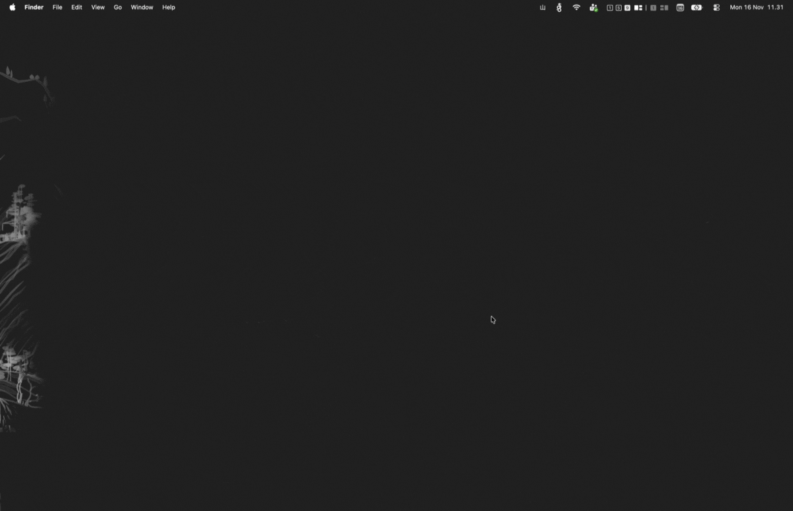

# Shan Shui for macOS



A brush that never finishes. Shan Shui draws a mountain landscape on your Mac's desktop, a
little more every second, and rolls the paper on when the screen is full. It sits behind
your windows and icons, and the same painting is your screen saver.

Every landscape is new: the mountains, trees, boats and pavilions are made up as the brush
reaches them.

## Install

```sh
brew install --cask kim-raaschou/tap/shanshui
open -a "Shan Shui"
```

For a Mac with Apple silicon and macOS 14 or later. Use Homebrew rather than
the zip: the build is signed ad hoc and not notarized, and the cask takes off the quarantine
that would otherwise keep macOS from opening it.

To remove it, `brew uninstall --cask shanshui`; add `--zap` to take its settings and saved
landscape along.

## Using it

Look for 山 in the menu bar. A click opens the menu; a right-click turns the painting on and
off.

| | |
|---|---|
| **Pause**, **Skip ahead**, **New landscape** | stop the brush, jump half a screen, or start over on blank paper |
| **Lightest settings** | one layer, half resolution, 6 frames a second, ten minutes a screen and less energy, in one go |
| **Speed** | how long the brush takes to cross the screen, from 15 seconds to 10 minutes; five minutes to begin with |
| **Motion** | frames a second at most, 6 to 60. A slow brush uses fewer by itself |
| **Resolution** | how finely the landscape is drawn, 50 to 100 % of the screen's own pixels. Less is softer and takes less memory |
| **Colors** | *Theme* follows the Mac's light or dark appearance, *Accent* draws in your accent colour, *Rice paper* is dark ink on cream. *Invert* swaps ink and paper |
| **Depth** | one, two or three layers. With more than one, the far mountains move slower than the near hills |
| **Prefer** | *Less energy* lets the Mac's graphics do the least work; *Less memory* uses about half the memory and a little more energy |
| **Ease off in Low Power Mode** | half the frames while the Mac is in Low Power Mode |
| **Cost** | what the app itself spends: share of a core, memory and energy over the last five minutes, and the last hour as a line. What macOS spends moving the picture follows *Motion* and is not counted |

For the screen saver, choose **Shan Shui** in System Settings > Screen Saver. macOS keeps
the app out of the screen saver's folder, so the screen saver paints a landscape of its own,
always with the least work: one layer, half resolution, at most 6 frames a second and ten
minutes a screen.

The recording at the top is the app itself on an empty desktop, with the pointer led by a
script (`Tools/demo.swift`). It runs at 30 seconds a screen so there is something to see;
day to day it is a good deal calmer.

## What it costs

It is made to be left on. There is no GPU code of its own: the Mac's compositor moves the
picture, and the app only repaints the pixels the brush has just reached. When no part of
the desktop can be seen, or it is paused, it does nothing.

Measured on an M3 Max at 3456×2234, 14 frames a second, 2¼ minutes a screen, as a share of
one core on the app's main thread:

| | as it comes | with ink at every frame | memory |
|---|---|---|---|
| 1 layer | 0.95 % | 1.1 % | 53 MB |
| 3 layers | 1.3 % | 3.1 % | 80 MB |

As it comes, the paper rolls at every frame but new ink is laid a little less often.

A new stretch of landscape is drawn about once a screen, by a helper process at background
priority that exits when it is done. At 3440×1440 that takes about 1.7 seconds of one core,
about 0.3 % of a core over ten minutes a screen; a lower *Resolution* makes it less. In Low
Power Mode the paper rolls at half the frame rate.

## Settings and commands

The menu writes `~/.config/shanshui/config.json`, and the app reads it again whenever it
changes. Ink and paper (`ink`, `paper`) also take any `#rrggbb`.

Some things are not in the menu and are set in that file. These are on and take `false`:

| | |
|---|---|
| `inkInSteps` | new ink is laid in small steps instead of at every frame. Less work for the Mac |
| `fineEdge` | each stroke comes in pixel by pixel instead of two by two. A little more memory |
| `fpsAuto` | only the frames the motion needs are drawn, up to the *Motion* maximum |
| `displayColors` | the painting is kept in the screen's own colours, so the Mac need not convert it at every frame |

`back` is how the back layer is kept (*Prefer* in the menu): `"opaque"` (the default) with the
paper in it, which the Mac need not blend; `"mono"` one byte a pixel, with the Mac putting the
ink's colour on it, about half the memory; or `"blend"`, as the layers in front are kept.

The running app can be told what to do from a script:

```sh
S="/Applications/Shan Shui.app/Contents/MacOS/ShanShui"
"$S" pause        # resume carries on
"$S" new          # a new landscape
"$S" skip 0.5     # skip half a screen
"$S" toggle       # on or off; on and off say which
"$S" state        # what it is doing, as JSON
"$S" version      # the version and the build, as at the foot of the menu
```

## Where it comes from

Shan Shui for macOS is a port of
[omarchy-shanshui](https://github.com/zednaked/omarchy-shanshui) by ZeD, a plugin for the
Omarchy desktop on Linux. The idea, the look and the way the picture is revealed are his,
and his README explains how the painting works. The landscapes themselves come from
[{Shan, Shui}*](https://github.com/LingDong-/shan-shui-inf) by LingDong-, whose generator
is here in Swift, giving the same landscape as his for the same seed.

What this port does its own way:

- **No shader.** The original reveals the picture in a GPU shader over the whole screen at
  every frame. Here the same arithmetic runs on the CPU, only where the brush is, and is
  checked against the shader pixel by pixel (`make test`).
- **No JavaScript.** The original runs LingDong-'s generator in Node and draws it with
  librsvg. Here the generator is Swift and CoreGraphics draws it, so there is nothing to
  install besides the app. The Swift was checked against the original JavaScript, which
  wrote the same drawings character for character, and the landscapes are held to that by
  their fingerprints (`make test`).
- **Additions.** The screen saver, sliders for speed and motion, two layers as well as one
  and three, ink laid in steps and a finer brush edge.
- **Left out.** Portuguese in the menu, and the original's guards against a tampered home
  folder when it writes its files.

Settings and saved landscapes are kept as the original keeps them, in folders of their own
(`shanshui` where the original has `zed.shanshui`). The original is written in Portuguese;
here the keys, the commands and the names in the code are English (`ink` for `tinta`,
`layers` for `camadas`, `Landscape.swift` for `Paisagem.qml`).

## Building it

Xcode's command line tools are all it needs.

```sh
make run     # build, install to /Applications and ~/Library/Screen Savers, start
make test    # the CPU painter against the shader's arithmetic, and the landscapes against their fingerprints
make bench   # time the painter
```

The painter is one C file (`Sources/Core/paint.c`), the generator is the `ShanShui*.swift`
files beside it with the original's names, and the rest is Swift under `Sources/`.

## License

MIT, see [LICENSE](LICENSE). The scroll is ZeD's and the mountains are LingDong-'s, whose
license is in [THIRD-PARTY.md](THIRD-PARTY.md).
